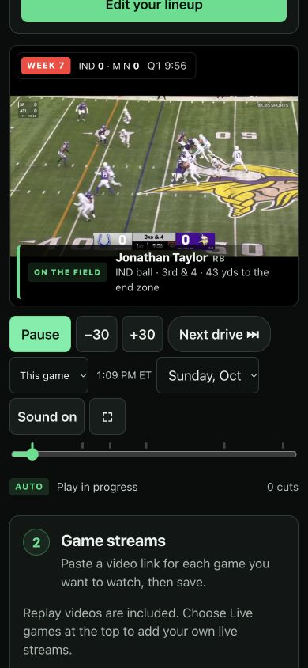

# Family-readiness audit — 2026-10-31

Historical report for commit `829cea6`. The subsequent
[full logic audit](full-logic-audit.md) records further findings and corrections.
Counts and preservation statements below describe this earlier pass.

Reviewed baseline: `d019282b3eab75e3dc69802c8a29afaeeb745453`.
This pass covers browser interaction, lineup persistence, asynchronous imports,
player lifecycle, replay transitions, failure recovery, accessibility details,
saved preferences, public Worker endpoints, and deployment packaging.

The source corrections pass the checks below. The updated version still needs
deployment and a production smoke check. Real playback was tested against the
previously deployed version, not the un-deployed corrections. This report does
not promise that every external stream will work or every snap will be shown.

## Confirmed issues and corrections

| Area | Failure reproduced or identified | Correction |
| --- | --- | --- |
| Live versus historical lineup | Week 7 imports or edits could overwrite the Sunday lineup and its persisted copy. | Separate lineup snapshots; replay persistence preserves the live selection. Returning live restores it. |
| First replay | A new Jonathan Taylor lineup opened hours before its first game. | Begin near the selected lineup’s first action; preserve a previously visited replay time. |
| Replay day and rewind | A player from the previous day, or a later point in the same game, could pull the clock back to its playhead. | Release obsolete players/pins before changing days or seeking before their game. |
| Picture and highlight options | Tracker mode could still resolve video highlights; changing options could leave an old highlight active. | Invalidate prepared sources, close/requeue affected highlights, and apply tracker mode before clip resolution. Turning replays off clears the active replay and queue. |
| Slow startup | Revealing a waiting player after eight seconds cleared its pending state, bypassing the twenty-second load timeout. | Retain the load deadline through the gesture prompt; commit once when playback is ready, or cool the failed source. |
| Pause and sound recovery | A delayed native sound watchdog could restart a paused video. Provider watchdogs could falsely report an audio lock while paused. | Cancel watchdogs on Pause and check playback intent before recovery. Native autoplay denial also exposes the sound-unlock hint. |
| Live watched coverage | A prior 60× replay setting enlarged the allowed live coverage gap. | Live coverage uses its own five-second maximum gap. |
| Saved browser data | Null or malformed saved fields could break startup or settings. Storage failures were silent. | Normalize fields independently; preserve valid older lineups; display a session-only warning when saving fails. |
| Manual lineup | Duplicate starters could distort ranking and credited scores. Invalid rows were difficult to locate. | Reject duplicates and focus/mark the offending field. |
| Stream entry and status | Draft links disappeared across mode changes; loading or failed video could say the slate had finished. | Retain draft links, show accurate loading/failure status, and provide Retry video. Fragment-bearing direct video URLs retain their native player type. |
| Public ESPN boundary | A caller-controlled identity header could select shared environment credentials. | Public requests cannot use shared credentials or expose the configured league ID. Only an explicitly enabled local preview can do so. Viewers can still import using their own cookies. |
| Private-league input | One entered cookie was silently discarded by the client. The server accepted overly loose SWID syntax. | Send partial input for an explanatory validation error; require both cookies and a valid paired-brace GUID. |
| Accessibility and wording | Long mobile lineup forms hid Save below the scroll; hidden players could retain focusability; settings lacked tab-panel relationships. | Keep Close/Save outside the scrolling lineup body, focus invalid fields, preserve game-button focus, fix player tab stops and settings relationships, clarify Close and playback status, and qualify possession/replay claims. |

The lineup remains above the player and Game streams remains directly below it.
The visible setup uses numbered steps and plain labels. Private ESPN cookie
extraction is still an advanced flow; manual player entry is the simpler option.

## Preserved logic

This pass does not change the director, archive sampling, score parsing,
recording alignment, coverage algorithm, delayed live feed, or replay matcher.
`web/director.js`, `archive.js`, `sync.js`, `scoring.js`, `coverage.js`,
`live.js`, and `replays.js` are unchanged from this pass’s baseline.
The provider’s bootstrap handshake, seek compensation, and advancing-time
confirmation remain intact. Its only changes in this pass cancel and guard
the audio watchdog on Pause. Changes to when these modules are called are
covered separately by app regression tests.

## Verification

- **376 tests pass**, including the existing Sunday rehearsal and player,
  alignment, director, API, scoring, feed, and coverage suites.
- **16 new `family:` app cases fail against `d019282` and pass after these
  corrections.** The harness uses real domain modules and, where relevant,
  the real player pool with simulated media/network boundaries. These are
  state-transition regressions, not browser playback tests.
- The six earlier `audit:` regressions remain in the suite.
- **60,000 sequential eligible-stream director decisions** match the original
  pre-review implementation (`22d3d1d`); two exclusion negative controls still
  reproduce the original defects. This demonstrates preservation for those
  simulated scenarios, not exhaustive equivalence for every possible input.
- The rebuilt Worker includes **24 assets** and passes JavaScript syntax checks.
  Direct Worker smoke checks compare served assets to source and check the
  public session boundary, HEAD, 404, and 405 responses.
- `git diff --check` passes.

Run from the repository root:

```sh
npm ci
npm test
node scripts/audit-director.mjs
npm run build
node --check dist/server/index.js
```

Reproduce the new failures against the prior app (expected to fail):

```sh
git show d019282b3eab75e3dc69802c8a29afaeeb745453:web/app.js > /tmp/fantasy-stream-before-family.js
FANTASY_AUDIT_APP=/tmp/fantasy-stream-before-family.js node --test --test-name-pattern='family:' tests/app.test.js
```

This historical comparison runs the old app orchestration with the current
harness and domain modules. It is deliberately scoped to the reproduced bugs.

## Browser evidence from the deployed baseline

Tested `https://fantasy-stream.fantasy-hub.workers.dev` in the available desktop
browser and a 390 × 844 mobile viewport:

- Fresh Live games page, empty-lineup validation, and manual Jonathan Taylor /
  IND / RB save. The upcoming IND @ JAX game and stream input appeared.
- Week 7 replay start, kickoff skip, next drive, real provider footage advancing,
  and Pause/Resume with subsequent footage advancing again.
- Clear rejection of an HTTP stream URL and a nonnumeric ESPN league ID.
- No warning/error console entries during the observed playback checks.
- No horizontal overflow at 390 pixels. The lineup dialog fit the viewport,
  but Save required scrolling; the footer correction above addresses that.



The screenshot is evidence for baseline playback, not the newly corrected UI.
Local preview was blocked by this session’s server-binding/browser restrictions,
so the final footer, focus changes, and all new transitions still need a browser
smoke check after deployment. No 320-pixel or physical-device result is claimed.

## Deployment and handoff

The deploy script runs `npm run build && wrangler deploy`; `wrangler.toml`
targets the existing `fantasy-stream` Worker. With dependencies installed and
the intended Cloudflare account authenticated, use:

```sh
cd "/Users/marcusmccarty/Documents/Codex/2026-10-25/new-chat-2/sites/fantasy-director" &&
git pull --ff-only &&
npm run deploy
```

After deployment, reload the site and check the following with the actual
browser/device and broadcast URLs intended for Sunday:

1. Save a live lineup, visit replay, change the replay lineup, return live,
   and reload. The live lineup must remain intact.
2. On a phone, open a long lineup; Close and Save must remain reachable while
   its rows scroll. Try an incomplete and a duplicate player.
3. Play and pause real video, including immediately after requesting sound.
   Try a replacement link and a failed link, then Retry video.
4. Change replay day, rewind before kickoff, and toggle tracker/highlights.
   Old footage must not pull the clock back or remain playing.
5. Import the actual public/private ESPN league and explicitly confirm the
   correct team and starters. A real private account was not exercised here.
6. Check the actual live feeds during games and adjust delay. One delay cannot
   perfectly align sources with different latency. Possession inference does
   not know player substitutions. Embedded pages can block framing, require a
   Play click, or show ads the app cannot detect; highlights require footage.

No Cloudflare deployment was performed as part of this audit. The remaining
production checks above are necessary before calling the release verified for
friends and family.
